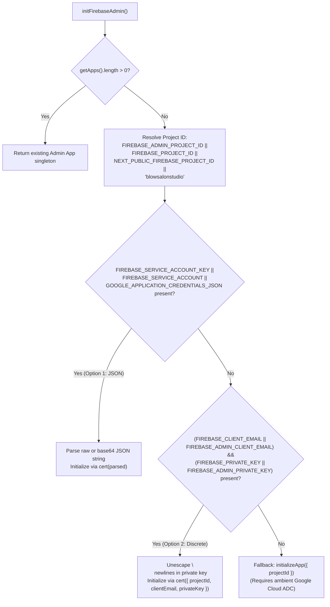
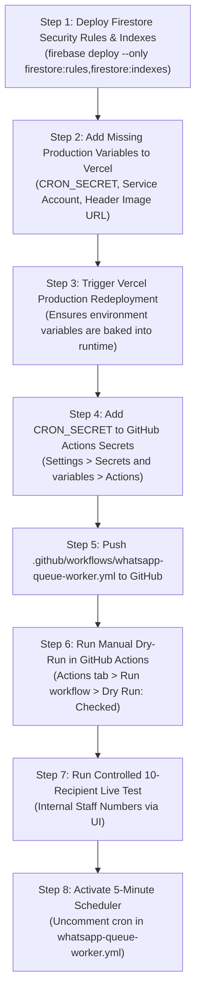

# BLOW SALON — Final Environment Variable Presence & Deployment Readiness Audit

**Document Version:** 1.0.0  
**Audit Date:** November 4, 2026  
**Auditor:** DeepMind Antigravity Engineering Agent  
**Environment:** Next.js 16.2.7 (Vercel Hobby) + GitHub Actions + Firebase Firestore + Meta WhatsApp Cloud API  
**Target Repository:** `srishanthreddyy/blow-salon` (`c:\clients\blow-salon`)  
**Production Domain:** `https://blowsalonstudio.vercel.app`

---

## 1. Firebase Admin Configuration — Actual Production Logic

Inspected [`lib/firebaseAdmin.ts`](file:///c:/clients/blow-salon/lib/firebaseAdmin.ts#L19-L75).

The server-side Firebase Admin SDK initializes a singleton instance (`initFirebaseAdmin()`) using one of three deterministic evaluation branches:



### Exact Resolution of `FIREBASE_*` Variable Variants

| Variable Variant | Code Reference in `lib/firebaseAdmin.ts` | Role & Status in Production | Required in Production? |
| :--- | :--- | :--- | :---: |
| **`FIREBASE_SERVICE_ACCOUNT_KEY`** | Lines 32–36 (`serviceAccountRaw`) | **Option 1 (Recommended)**: Stringified JSON or base64 service account key. Contains `project_id`, `client_email`, and `private_key` in one single string. | **YES (if Option 2 is not used)** |
| **`FIREBASE_CLIENT_EMAIL`** | Line 55 (`clientEmail`) | **Option 2 Primary**: Discrete service account email address. | **YES (if Option 1 is not used)** |
| **`FIREBASE_PRIVATE_KEY`** | Line 56 (`privateKey`) | **Option 2 Primary**: Discrete PEM RSA private key string with `\n` linebreaks. | **YES (if Option 1 is not used)** |
| **`FIREBASE_PROJECT_ID`** | Line 27 (`projectId`) | Primary project identifier for Firebase Admin and Firebase Client. | **YES (Always recommended)** |
| **`FIREBASE_ADMIN_PROJECT_ID`** | Line 26 (`projectId`) | Supported alias for `FIREBASE_PROJECT_ID`. Code reads this first. | Optional Alias |
| **`FIREBASE_ADMIN_CLIENT_EMAIL`** | Line 55 (`clientEmail`) | Supported alias for `FIREBASE_CLIENT_EMAIL`. | Optional Alias |
| **`FIREBASE_ADMIN_PRIVATE_KEY`** | Line 56 (`privateKey`) | Supported alias for `FIREBASE_PRIVATE_KEY`. | Optional Alias |
| **`FIREBASE_SERVICE_ACCOUNT`** | Line 34 (`serviceAccountRaw`) | Supported alias for `FIREBASE_SERVICE_ACCOUNT_KEY`. | Optional Alias |
| **`GOOGLE_APPLICATION_CREDENTIALS_JSON`** | Line 35 (`serviceAccountRaw`) | Supported alias for `FIREBASE_SERVICE_ACCOUNT_KEY`. | Optional Alias |

### The Production Choice
You only need to supply **ONE** of the following two credential combinations in Vercel:

- **Option 1 (Simplest & Recommended):**  
  Configure **`FIREBASE_SERVICE_ACCOUNT_KEY`** (the raw stringified JSON or base64 JSON from your Google Cloud service account) and **`FIREBASE_PROJECT_ID`** (`blowsalonstudio`).  
  *No other private key or client email variable is needed.*
- **Option 2 (Discrete Variables):**  
  Configure **`FIREBASE_CLIENT_EMAIL`**, **`FIREBASE_PRIVATE_KEY`** (with newline `\n` characters), and **`FIREBASE_PROJECT_ID`**.

---

## 2. Local Environment Files Audit

*Audit Note:* File `.env` is **NOT APPLICABLE** as it does not exist on disk. `.env.local` is present locally.

| Variable Name | Required | Present in `.env` | Present in `.env.local` | Used in Production | Vercel Action Required |
| :--- | :---: | :---: | :---: | :---: | :--- |
| `NEXT_PUBLIC_FIREBASE_API_KEY` | YES | NOT APPLICABLE | **PRESENT** | YES | **RETAIN EXISTING** in Vercel |
| `NEXT_PUBLIC_FIREBASE_AUTH_DOMAIN` | YES | NOT APPLICABLE | **PRESENT** | YES | **RETAIN EXISTING** in Vercel |
| `NEXT_PUBLIC_FIREBASE_PROJECT_ID` | YES | NOT APPLICABLE | **PRESENT** | YES | **RETAIN EXISTING** in Vercel |
| `NEXT_PUBLIC_FIREBASE_STORAGE_BUCKET` | YES | NOT APPLICABLE | **PRESENT** | YES | **RETAIN EXISTING** in Vercel |
| `NEXT_PUBLIC_FIREBASE_MESSAGING_SENDER_ID` | YES | NOT APPLICABLE | **PRESENT** | YES | **RETAIN EXISTING** in Vercel |
| `NEXT_PUBLIC_FIREBASE_APP_ID` | YES | NOT APPLICABLE | **PRESENT** | YES | **RETAIN EXISTING** in Vercel |
| `FIREBASE_SERVICE_ACCOUNT_KEY` | YES (Option 1) | NOT APPLICABLE | **MISSING** | YES | **ADD TO VERCEL** (if using Option 1) |
| `FIREBASE_CLIENT_EMAIL` | YES (Option 2) | NOT APPLICABLE | **MISSING** | YES | **ADD TO VERCEL** (if using Option 2) |
| `FIREBASE_PRIVATE_KEY` | YES (Option 2) | NOT APPLICABLE | **MISSING** | YES | **ADD TO VERCEL** (if using Option 2) |
| `FIREBASE_PROJECT_ID` | YES | NOT APPLICABLE | **MISSING** | YES | **ADD TO VERCEL** (`blowsalonstudio`) |
| `CRON_SECRET` | YES | NOT APPLICABLE | **MISSING** | YES | **ADD TO VERCEL** (Must match GitHub secret) |
| `WHATSAPP_ACCESS_TOKEN` | YES | NOT APPLICABLE | **PRESENT** | YES | **RETAIN EXISTING** in Vercel |
| `WHATSAPP_PHONE_NUMBER_ID` | YES | NOT APPLICABLE | **PRESENT** | YES | **RETAIN EXISTING** in Vercel |
| `WHATSAPP_VERIFY_TOKEN` | YES | NOT APPLICABLE | **PRESENT** | YES | **RETAIN EXISTING** in Vercel |
| `WHATSAPP_BUSINESS_ACCOUNT_ID` | OPTIONAL | NOT APPLICABLE | **PRESENT** | YES | **RETAIN EXISTING** in Vercel |
| `WHATSAPP_CLOUD_API_VERSION` | OPTIONAL | NOT APPLICABLE | **PRESENT** | YES | **RETAIN EXISTING** in Vercel |
| `WHATSAPP_APP_SECRET` | OPTIONAL | NOT APPLICABLE | **PRESENT** | YES | **RETAIN EXISTING** in Vercel |
| `WHATSAPP_TEMPLATE_HEADER_IMAGE_URL` | YES | NOT APPLICABLE | **MISSING** | YES | **ADD TO VERCEL** (`https://blowsalonstudio.vercel.app/blowtemplate.png`) |
| `CLOUDINARY_CLOUD_NAME` | OPTIONAL | NOT APPLICABLE | **PRESENT** | YES | **RETAIN EXISTING** in Vercel |
| `CLOUDINARY_UPLOAD_PRESET` | OPTIONAL | NOT APPLICABLE | **PRESENT** | YES | **RETAIN EXISTING** in Vercel |
| `NEXT_PUBLIC_META_APP_ID` | OPTIONAL | NOT APPLICABLE | **PRESENT** | YES | **RETAIN EXISTING** in Vercel |
| `NEXT_PUBLIC_FACEBOOK_APP_ID` | OPTIONAL | NOT APPLICABLE | **MISSING** | YES | NOT NEEDED (Alias for `NEXT_PUBLIC_META_APP_ID`) |
| `FIREBASE_ADMIN_PROJECT_ID` | OPTIONAL | NOT APPLICABLE | **MISSING** | YES | OPTIONAL (Alias for `FIREBASE_PROJECT_ID`) |
| `FIREBASE_ADMIN_CLIENT_EMAIL` | OPTIONAL | NOT APPLICABLE | **MISSING** | YES | OPTIONAL (Alias for `FIREBASE_CLIENT_EMAIL`) |
| `FIREBASE_ADMIN_PRIVATE_KEY` | OPTIONAL | NOT APPLICABLE | **MISSING** | YES | OPTIONAL (Alias for `FIREBASE_PRIVATE_KEY`) |
| `FIREBASE_SERVICE_ACCOUNT` | OPTIONAL | NOT APPLICABLE | **MISSING** | YES | NOT NEEDED (Alias for `FIREBASE_SERVICE_ACCOUNT_KEY`) |
| `GOOGLE_APPLICATION_CREDENTIALS_JSON` | OPTIONAL | NOT APPLICABLE | **MISSING** | YES | NOT NEEDED (Alias for `FIREBASE_SERVICE_ACCOUNT_KEY`) |
| `WHATSAPP_SEND_DELAY_MS` | OPTIONAL | NOT APPLICABLE | **MISSING** | YES | OPTIONAL (Defaults to `3000` = 3s) |
| `WHATSAPP_MAX_CONCURRENCY` | OPTIONAL | NOT APPLICABLE | **MISSING** | YES | OPTIONAL (Defaults to `1`) |
| `WHATSAPP_MAX_RETRIES` | OPTIONAL | NOT APPLICABLE | **MISSING** | YES | OPTIONAL (Defaults to `3`) |
| `WHATSAPP_MIN_DELAY_MS` | OPTIONAL | NOT APPLICABLE | **MISSING** | YES | OPTIONAL (Defaults to `1000`) |
| `WHATSAPP_MAX_DELAY_MS` | OPTIONAL | NOT APPLICABLE | **MISSING** | YES | OPTIONAL (Defaults to `30000`) |
| `WHATSAPP_DAILY_SAFETY_BUDGET` | OPTIONAL | NOT APPLICABLE | **MISSING** | YES | OPTIONAL (Defaults to `1800`) |
| `WHATSAPP_WORKER_SECRET` | OPTIONAL | NOT APPLICABLE | **MISSING** | YES | NOT NEEDED (Alias for `CRON_SECRET`) |
| `WHATSAPP_SERVICE_SECRET` | OPTIONAL | NOT APPLICABLE | **MISSING** | YES | NOT NEEDED (Internal fallback alias) |
| `NEXTAUTH_SECRET` | OPTIONAL | NOT APPLICABLE | **MISSING** | YES | NOT NEEDED (Internal fallback alias) |
| `WHATSAPP_DEBUG_AUTH` | OPTIONAL | NOT APPLICABLE | **MISSING** | NO | NOT NEEDED (Local diagnostic flag only) |
| `NODE_ENV` | OPTIONAL | NOT APPLICABLE | **MISSING** | YES | NOT NEEDED (Set automatically by Vercel) |
| `NODE_TEST_CONTEXT` | OPTIONAL | NOT APPLICABLE | **MISSING** | NO | NOT NEEDED (Node test runner flag only) |

---

## 3. Vercel Requirements Breakdown

### A. Required for Core Application (Frontend & Auth)
| Variable Name | Required? | Sensitive? | Vercel Environments | Redeployment Required? |
| :--- | :---: | :---: | :---: | :---: |
| `NEXT_PUBLIC_FIREBASE_API_KEY` | YES | Public | Production, Preview, Development | YES |
| `NEXT_PUBLIC_FIREBASE_AUTH_DOMAIN` | YES | Public | Production, Preview, Development | YES |
| `NEXT_PUBLIC_FIREBASE_PROJECT_ID` | YES | Public | Production, Preview, Development | YES |
| `NEXT_PUBLIC_FIREBASE_STORAGE_BUCKET` | YES | Public | Production, Preview, Development | YES |
| `NEXT_PUBLIC_FIREBASE_MESSAGING_SENDER_ID` | YES | Public | Production, Preview, Development | YES |
| `NEXT_PUBLIC_FIREBASE_APP_ID` | YES | Public | Production, Preview, Development | YES |

### B. Required for Firebase Admin & Persistent Queue
| Variable Name | Required? | Sensitive? | Vercel Environments | Redeployment Required? |
| :--- | :---: | :---: | :---: | :---: |
| **`CRON_SECRET`** | **YES** | **YES** | Production, Preview | **YES** |
| **`FIREBASE_SERVICE_ACCOUNT_KEY`** *(Option 1)* | **YES** | **YES** | Production, Preview | **YES** |
| **`FIREBASE_CLIENT_EMAIL`** *(Option 2)* | If Option 1 empty | No | Production, Preview | **YES** |
| **`FIREBASE_PRIVATE_KEY`** *(Option 2)* | If Option 1 empty | **YES** | Production, Preview | **YES** |
| **`FIREBASE_PROJECT_ID`** | **YES** | No | Production, Preview | **YES** |

### C. Required for Meta WhatsApp Cloud API
| Variable Name | Required? | Sensitive? | Vercel Environments | Redeployment Required? |
| :--- | :---: | :---: | :---: | :---: |
| `WHATSAPP_ACCESS_TOKEN` | **YES** | **YES** | Production, Preview | **YES** |
| `WHATSAPP_PHONE_NUMBER_ID` | **YES** | No | Production, Preview | **YES** |
| `WHATSAPP_TEMPLATE_HEADER_IMAGE_URL` | **YES** | Public | Production, Preview, Development | **YES** |

### D. Required for Webhook Verification
| Variable Name | Required? | Sensitive? | Vercel Environments | Redeployment Required? |
| :--- | :---: | :---: | :---: | :---: |
| `WHATSAPP_VERIFY_TOKEN` | **YES** | **YES** | Production, Preview | **YES** |
| `WHATSAPP_APP_SECRET` | Optional | **YES** | Production, Preview | **YES** |

### E. Required for Cloudinary Campaign Images
| Variable Name | Required? | Sensitive? | Vercel Environments | Redeployment Required? |
| :--- | :---: | :---: | :---: | :---: |
| `CLOUDINARY_CLOUD_NAME` | Optional (has fallback) | Public | Production, Preview, Development | **YES** |
| `CLOUDINARY_UPLOAD_PRESET` | Optional (has fallback) | Public | Production, Preview, Development | **YES** |

### F. Optional Configuration (Safe Defaults Built-in)
- `WHATSAPP_BUSINESS_ACCOUNT_ID` (Defaults from `settings/whatsapp_coexistence` doc)
- `WHATSAPP_CLOUD_API_VERSION` (Defaults to `v21.0`)
- `WHATSAPP_SEND_DELAY_MS` (Defaults to `3000` = 3.0s)
- `WHATSAPP_MAX_CONCURRENCY` (Defaults to `1`)
- `WHATSAPP_MAX_RETRIES` (Defaults to `3`)
- `WHATSAPP_MIN_DELAY_MS` (Defaults to `1000`)
- `WHATSAPP_MAX_DELAY_MS` (Defaults to `30000`)
- `WHATSAPP_DAILY_SAFETY_BUDGET` (Defaults to `1800` for 2K tier)
- `NEXT_PUBLIC_META_APP_ID` (Used in Embedded Signup popup)

### G. Local-Only Variables
- `NODE_ENV` (Managed automatically by Next.js / Vercel runtime)
- `NODE_TEST_CONTEXT` (Set by Node.js test runner)
- `WHATSAPP_DEBUG_AUTH` (Enables local header logs during testing)

### H. Deprecated / Unused Variables (Safely Ignored)
- `NEXT_PUBLIC_FACEBOOK_APP_ID` (Superseded by `NEXT_PUBLIC_META_APP_ID`)
- `FIREBASE_ADMIN_PROJECT_ID` (Supported alias for `FIREBASE_PROJECT_ID`)
- `FIREBASE_ADMIN_CLIENT_EMAIL` (Supported alias for `FIREBASE_CLIENT_EMAIL`)
- `FIREBASE_ADMIN_PRIVATE_KEY` (Supported alias for `FIREBASE_PRIVATE_KEY`)
- `FIREBASE_SERVICE_ACCOUNT` (Supported alias for `FIREBASE_SERVICE_ACCOUNT_KEY`)
- `GOOGLE_APPLICATION_CREDENTIALS_JSON` (Supported alias for `FIREBASE_SERVICE_ACCOUNT_KEY`)
- `WHATSAPP_WORKER_SECRET` (Supported alias for `CRON_SECRET`)
- `WHATSAPP_SERVICE_SECRET` / `NEXTAUTH_SECRET` (Fallback aliases)

---

## 4. GitHub Actions Configuration Verification

Inspected [`.github/workflows/whatsapp-queue-worker.yml`](file:///c:/clients/blow-salon/.github/workflows/whatsapp-queue-worker.yml):

1. **`CRON_SECRET` is the only required GitHub Actions secret:**  
   **CONFIRMED.** Step `Validate Secrets Configuration` validates `CRON_SECRET_VALUE: ${{ secrets.CRON_SECRET }}` and halts with error if absent. No other secret is queried.
2. **`WORKER_URL` is the optional endpoint variable:**  
   **CONFIRMED.** Line 33 uses `TARGET_URL: ${{ vars.WORKER_URL || 'https://blowsalonstudio.vercel.app/api/whatsapp/queue/worker' }}`.
3. **Workflow uses POST:**  
   **CONFIRMED.** Line 51 specifies `-X POST`.
4. **Authorization uses Bearer `CRON_SECRET`:**  
   **CONFIRMED.** Line 52 specifies `-H "Authorization: Bearer ${CRON_SECRET}"`.
5. **No Firebase Admin private key sent to GitHub:**  
   **CONFIRMED.** Zero Firebase keys, emails, or credentials exist in `.github/workflows/whatsapp-queue-worker.yml`.
6. **No WhatsApp access token sent to GitHub:**  
   **CONFIRMED.** Zero WhatsApp API access tokens exist in the workflow file.
7. **Dry-run defaults to `true` for manual execution:**  
   **CONFIRMED.** Lines 13–17 declare input `dry_run` with `type: boolean` and `default: true`.
8. **Scheduled executions use live mode only after cron line enabled:**  
   **CONFIRMED.** Line 35 evaluates `IS_DRY_RUN: ${{ github.event_name == 'workflow_dispatch' && inputs.dry_run == true }}`. On a scheduled run (`github.event_name == 'schedule'`), `IS_DRY_RUN` evaluates to `false` (live dispatch).
9. **Concurrency configured:**  
   **CONFIRMED.** Lines 19–21 enforce `concurrency: { group: whatsapp-queue-worker, cancel-in-progress: false }`.
10. **HTTP failures cause visible workflow failure:**  
    **CONFIRMED.** Line 50 uses `--fail-with-body`, and lines 56–60 verify `CURL_EXIT -ne 0` and trigger an error exit with server response.
11. **No secret printed in logs:**  
    **CONFIRMED.** Secret is injected through environment variable `CRON_SECRET: ${{ secrets.CRON_SECRET }}` and masked automatically by the runner (`***`). No verbose curl flags (`-v`, `-x`, `--trace`) are used.
12. **Cron schedule disabled by default:**  
    **CONFIRMED.** Line 8 `# - cron: '*/5 * * * *'` remains safely commented out.

---

## 5. Production Safety Verification

| Safety Invariant | Status | Verification Evidence |
| :--- | :---: | :--- |
| **5.1 Firestore Queue Rules Deny Client Access** | **VERIFIED** | [`firestore.rules#L79-L98`](file:///c:/clients/blow-salon/firestore.rules#L79-L98) enforces `allow read, write: if false;` on `whatsappCampaignJobs`, `whatsapp_campaigns`, `whatsapp_campaign_recipients`, and `whatsapp_messages`. Catch-all deny-all prevents rule bypasses. |
| **5.2 Firebase Admin Operations Supported** | **VERIFIED** | [`lib/firebaseAdmin.ts`](file:///c:/clients/blow-salon/lib/firebaseAdmin.ts) operates via privileged `adminDb`. Supported by Option 1 (`FIREBASE_SERVICE_ACCOUNT_KEY`) or Option 2 (`FIREBASE_CLIENT_EMAIL` + `FIREBASE_PRIVATE_KEY`). |
| **5.3 Worker Authentication Works** | **VERIFIED** | [`lib/whatsapp/auth.ts#L21-L35`](file:///c:/clients/blow-salon/lib/whatsapp/auth.ts#L21-L35) verifies Bearer token. Query-string tokens strictly rejected. Covered by automated test Scenario 36. |
| **5.4 Dry-Run Makes Zero Meta API Calls** | **VERIFIED** | [`lib/whatsapp/queue/queueManager.ts#L750-L840`](file:///c:/clients/blow-salon/lib/whatsapp/queue/queueManager.ts#L750-L840) queries due jobs in read-only mode and returns simulation array without calling `provider.sendTemplateMessage`. Covered by Scenario 37. |
| **5.5 Dry-Run Makes Zero Firestore Writes** | **VERIFIED** | [`lib/whatsapp/queue/queueManager.ts#L750-L840`](file:///c:/clients/blow-salon/lib/whatsapp/queue/queueManager.ts#L750-L840) executes zero `setDoc`, `updateDoc`, or batch commits during dry run. Covered by Scenario 37. |
| **5.6 Existing Campaign Records Untouched** | **VERIFIED** | Dry run performs zero mutations. Live queue batching only claims jobs belonging to campaigns in active `SENDING` state. |
| **5.7 Historical Recovery Does Not Run Automatically** | **VERIFIED** | Historical campaigns (`DIWALI OFFER`, `35% DISCOUNT`) are blocked by [`lib/whatsapp/historicalCampaignGuard.ts`](file:///c:/clients/blow-salon/lib/whatsapp/historicalCampaignGuard.ts). |
| **5.8 WhatsApp Master Kill-Switch Works** | **VERIFIED** | Checked at the start of worker execution via `assertWhatsAppEnabled()` in [`app/api/whatsapp/queue/worker/route.ts#L23-L29`](file:///c:/clients/blow-salon/app/api/whatsapp/queue/worker/route.ts#L23-L29). |

---

## 6. Exact Deployment Order & Action Plan



### Step 1: Deploy Firestore Security Rules & Indexes
From your local terminal, deploy rules and indexes to production Firebase:
```powershell
firebase deploy --only firestore:rules,firestore:indexes
```

### Step 2: Configure Missing Vercel Environment Variables
In **Vercel Dashboard $\to$ Settings $\to$ Environment Variables**, ensure the following 4 missing variables are added:
1. **`CRON_SECRET`**: Generate a secure 32+ character string (e.g. `openssl rand -hex 24`).
2. **`FIREBASE_SERVICE_ACCOUNT_KEY`** *(or Option B: `FIREBASE_CLIENT_EMAIL` & `FIREBASE_PRIVATE_KEY`)*: Enter your Firebase service account JSON.
3. **`FIREBASE_PROJECT_ID`**: Set to `blowsalonstudio`.
4. **`WHATSAPP_TEMPLATE_HEADER_IMAGE_URL`**: Set to `https://blowsalonstudio.vercel.app/blowtemplate.png`.

*Verify that existing variables from `.env.local` (`NEXT_PUBLIC_FIREBASE_*`, `WHATSAPP_ACCESS_TOKEN`, `WHATSAPP_PHONE_NUMBER_ID`, `WHATSAPP_VERIFY_TOKEN`) are already saved in Vercel.*

### Step 3: Trigger Vercel Production Redeployment
After saving environment variables in Vercel, trigger a redeployment in **Deployments $\to$ Redeploy** so the Node.js runtime receives the new secrets.

### Step 4: Configure GitHub Actions Secrets
In your GitHub repository:
1. Go to **Settings $\to$ Secrets and variables $\to$ Actions**.
2. Click **New repository secret**.
3. Name: **`CRON_SECRET`**.
4. Value: Paste the **exact same string** configured in Vercel in Step 2.

### Step 5: Push Workflow File to GitHub
Commit and push the created files to your GitHub `main` branch:
```powershell
git add .github/workflows/whatsapp-queue-worker.yml
git commit -m "feat(whatsapp): add GitHub Actions queue worker scheduler with dry-run support"
git push origin main
```

---

## 7. Exact Manual Dry-Run Test Procedure

1. Open your GitHub repository in your web browser.
2. Click on the **Actions** tab at the top.
3. In the left workflow list, select **WhatsApp Persistent Queue Worker**.
4. Click the **Run workflow** dropdown on the right side.
5. Verify that **"Dry Run Mode"** is checked (`true`).
6. Click the green **Run workflow** button.
7. Wait ~15 seconds and click on the newly triggered workflow run.
8. Click the job **Trigger Persistent Queue Worker** $\to$ expand step **Execute Queue Worker Batch**.
9. Verify the output log displays:
   - `Target Endpoint: https://blowsalonstudio.vercel.app/api/whatsapp/queue/worker`
   - `Dry Run Mode: true`
   - `Worker Execution Summary:`
     ```json
     {
       "success": true,
       "dryRun": true,
       "candidateCount": 0,
       "simulatedJobs": [],
       "message": "[DRY-RUN] Inspected queue. Found 0 due jobs. Zero messages sent. Zero records modified."
     }
     ```
10. Confirm the job succeeds with a green checkmark (`Exit code 0`).

---

## 8. Exact 10-Recipient Live Test Procedure

Once the dry-run passes:
1. Open the BLOW SALON web application at `https://blowsalonstudio.vercel.app`.
2. Navigate to **WhatsApp $\to$ Campaigns $\to$ Create Campaign**.
3. Title: `SYSTEM LIVE VERIFICATION - 10 RECIPIENTS`.
4. Audience: **CUSTOM** (select exactly 10 staff or QA phone numbers).
5. Template: Select **`blow_salon_campaign`**.
6. Content Variable {{2}}: `Live verification of BLOW SALON WhatsApp queue`.
7. Click **Create & Queue Campaign**.
8. Verify on the campaign detail modal that 10 recipients show `status: "PENDING"`.
9. Go to GitHub **Actions $\to$ WhatsApp Persistent Queue Worker $\to$ Run workflow**.
10. **UNCHECK** the **"Dry Run Mode"** box (`false`).
11. Click **Run workflow**.
12. Inspect the GitHub Actions runner log:
    - Verifies 6 jobs processed in the first batch with 3.0s delays.
    - Status updates to `ACCEPTED` with Meta message IDs (`wamid`).
13. Trigger the workflow one more time to process the remaining 4 jobs.
14. In the salon UI, confirm all 10 messages transition from `PENDING` $\to$ `SENT` $\to$ `DELIVERED` $\to$ `READ`.
15. Confirm zero jobs enter `AMBIGUOUS` state.
16. **Activate the 5-Minute Scheduler:**
    Open `.github/workflows/whatsapp-queue-worker.yml`, uncomment line 8 (`- cron: '*/5 * * * *'`), commit, and push.

