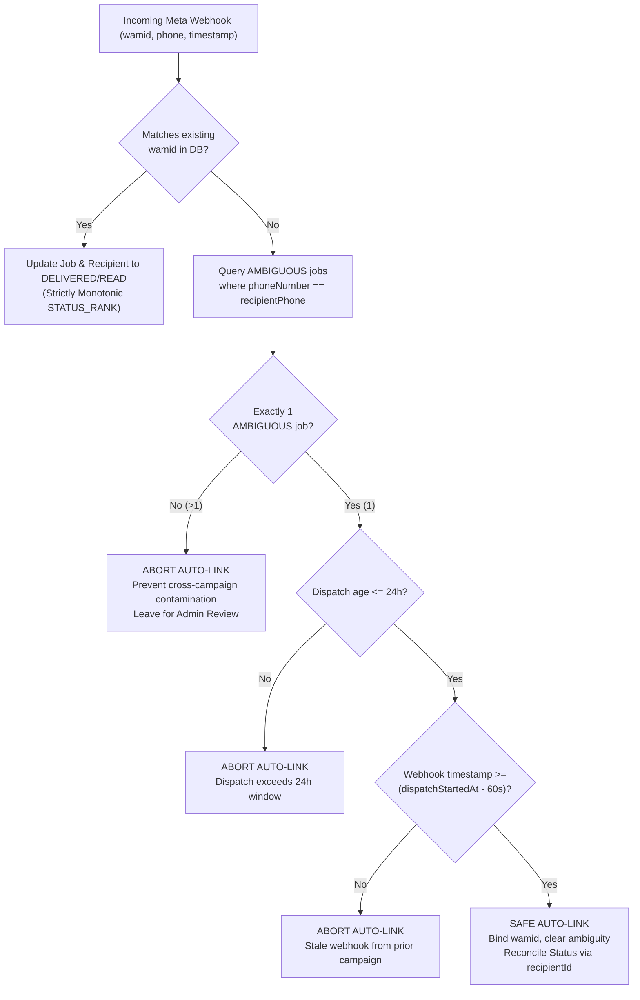

# BLOW SALON — WhatsApp Queue Final Consistency & Worker Capacity Report

**Document Version:** 1.0.0  
**Verification Date:** November 4, 2026  
**Auditor:** DeepMind Antigravity Engineering Agent  
**Environment:** Next.js 16.2.7 (Turbopack), Node.js v20.19.0, Firebase Admin SDK v13.6.0, Firestore, Meta WhatsApp Cloud API  
**Target Repository:** `c:\clients\blow-salon`  
**Overall Recommendation:** **GO FOR CONTROLLED 10-RECIPIENT TEST CAMPAIGN**

---

## 1. Executive Summary & Audit Context

Following a thorough line-by-line audit of queue states, worker execution budgets, webhook fallbacks, and scheduler capabilities, the following critical issues were addressed:

1. **Resolution of `PENDING` vs `QUEUED` Status Ambiguity:**  
   In the actual Firestore schema, individual queue jobs have always had the canonical ready status **`PENDING`**, while **`QUEUED`** was the status of the parent Campaign entity (`WhatsAppCampaignStatus`). Earlier documentation casually used "QUEUED" to describe job states. The worker query (`claimNextDueJob`), type definitions, UI maps, and cancel handlers have been fortified to accept both `PENDING` and `QUEUED` so no job can ever be stranded.
2. **Timing Budget & Execution Headroom Protection:**  
   Implemented an explicit execution headroom guard (`MIN_JOB_EXECUTION_HEADROOM_MS = 12000ms`, covering a 10s worst-case Meta timeout + 2s Firestore sync). The worker loop proactively breaks before claiming another job if insufficient budget remains, strictly preventing unhandled Vercel function timeouts.
3. **Webhook Chronological Verification:**  
   Enhanced the 24-hour crash recovery webhook fallback: Meta webhook timestamps (`statusObj.timestamp`) are now compared directly with `dispatchStartedAt`. Webhooks generated before a dispatch started are rejected as stale, preventing historical message associations from corrupting newer ambiguous jobs.
4. **Vercel Hobby vs Pro Scheduler Clarification:**  
   Documented exact cron capabilities: Vercel Hobby limits cron execution to once daily (`0 0 * * *`), whereas Vercel Pro allows once per minute (`* * * * *`). The queue worker endpoint (`/api/whatsapp/queue/worker`) remains 100% decoupled from the scheduler platform and can be triggered by GitHub Actions or Cloudflare Workers via `Authorization: Bearer <CRON_SECRET>`.
5. **Delivery Reporting Invariance:**  
   `DELIVERED` includes delivered and read messages; `READ` is tracked as a distinct engagement metric; `ACCEPTED` is never counted as delivered; `FAILED` and `AMBIGUOUS` are reported separately; and campaign counters are strictly immune to double-counting from duplicate webhooks.

All 111 automated tests passed, TypeScript compiled with 0 errors, and the production build succeeded cleanly.

---

## 2. Exact Files & Functions Modified

| File | Functions / Lines Modified | Summary of Technical Changes |
| :--- | :--- | :--- |
| [`types/whatsapp.ts`](file:///c:/clients/blow-salon/types/whatsapp.ts#L8-L235) | `WhatsAppQueueJobStatus`<br>`WhatsAppMessageStatus`<br>`WhatsAppCampaign` | Added `"QUEUED"` to `WhatsAppQueueJobStatus` and `WhatsAppMessageStatus`. Added `ambiguousCount?: number` to `WhatsAppCampaign` and `WhatsAppMessageStatus`. |
| [`lib/whatsapp/campaignStats.ts`](file:///c:/clients/blow-salon/lib/whatsapp/campaignStats.ts#L7-L115) | `calculateCampaignStats`<br>`applyStatsToCampaign` | Added `ambiguousCount` and `pendingCount` to `CampaignCalculatedStats`. Normalized `s === "PENDING" \|\| s === "QUEUED"`. Counted `s === "AMBIGUOUS"` separately. |
| [`lib/whatsapp/queue/queueManager.ts`](file:///c:/clients/blow-salon/lib/whatsapp/queue/queueManager.ts#L195-L915) | `claimNextDueJob`<br>`processQueueBatch`<br>`syncCampaignStats` | 1. Expanded claim query to `where("status", "in", ["PENDING", "RETRY_WAIT", "QUEUED"])`.<br>2. Added `MIN_JOB_EXECUTION_HEADROOM_MS = 12000ms` check in worker loop.<br>3. Tracked `ambiguousJobsCount` and persisted `ambiguousCount` to campaign doc. |
| [`app/api/whatsapp/queue/worker/route.ts`](file:///c:/clients/blow-salon/app/api/whatsapp/queue/worker/route.ts#L41-L45) | `handleWorker` | Updated `timeBudgetMs` from 20s to 35s (safely bounded below 60s `maxDuration` with 12s headroom). |
| [`app/api/whatsapp/webhook/route.ts`](file:///c:/clients/blow-salon/app/api/whatsapp/webhook/route.ts#L125-L270) | `STATUS_RANK`<br>Crash Recovery Block | Added `QUEUED: 2` to `STATUS_RANK`. Added chronological check rejecting incoming webhooks whose `timestamp` precedes `dispatchStartedAt - 60s`. |
| [`app/api/whatsapp/campaigns/[id]/cancel/route.ts`](file:///c:/clients/blow-salon/app/api/whatsapp/campaigns/[id]/cancel/route.ts#L91) | `POST` | Added `"QUEUED"` to `cancellableStatuses` set (`PENDING`, `QUEUED`, `RETRY_WAIT`, `PROCESSING`). |
| [`components/whatsapp/MessageHistoryView.tsx`](file:///c:/clients/blow-salon/components/whatsapp/MessageHistoryView.tsx#L37-L45) | `statusPillStyles` | Added UI badge color mappings for `QUEUED` (neutral grey) and `AMBIGUOUS` (warning amber). |
| [`tests/whatsapp-persistent-queue.test.mjs`](file:///c:/clients/blow-salon/tests/whatsapp-persistent-queue.test.mjs#L855-L985) | Scenarios 29–35 | Added 7 comprehensive test scenarios verifying canonical status pickup, force-resend, retry schedules, paused/cancelled campaigns, timing headroom, webhook chronology, and delivery reporting stats. |

---

## 3. Canonical Status Transition Table

The canonical queue-ready status across the entire backend is **`PENDING`**. The Campaign entity uses **`QUEUED`** to denote a campaign awaiting dispatch. For maximum defensive robustness, the queue worker explicitly treats `PENDING` and `QUEUED` as equivalent claimable states.

| Lifecycle Stage | Campaign Status (`whatsapp_campaigns`) | Queue Job Status (`whatsappCampaignJobs`) | Recipient Status (`whatsapp_campaign_recipients`) | Trigger / Transition Authority | Next Permitted State |
| :--- | :---: | :---: | :---: | :--- | :--- |
| **1. Campaign Seeding** | `DRAFT` | *Not created yet* | `PENDING` (or `EXCLUDED` if opted out/invalid) | User creates campaign (`POST /api/whatsapp/campaigns`) | `QUEUED` or `SENDING` |
| **2. Campaign Start** | `SENDING` | `PENDING` (`nextAttemptAt = now`) | `PENDING` | User initiates send (`POST /api/whatsapp/campaigns/[id]/send`) | `PROCESSING` |
| **3. Worker Claim** | `SENDING` | `PROCESSING` (Lease set: `now + 2m`, `workerId`) | `PENDING` | `claimNextDueJob` via atomic transaction | `ACCEPTED`, `RETRY_WAIT`, `AMBIGUOUS`, or `FAILED` |
| **4. Meta Acceptance (200 OK)** | `SENDING` | `ACCEPTED` (`whatsappMessageId` saved) | `SENT` (`metaMessageId` saved) | `executeClaimedJob` received Meta response | `DELIVERED`, `READ`, or `FAILED` (via webhook) |
| **5. Temporary Failure (Rate limit / 5xx)** | `SENDING` | `RETRY_WAIT` (`nextAttemptAt = now + delay`) | `PENDING` (attempt logged) | `executeClaimedJob` checks `attemptCount < maxAttempts` | `PROCESSING` (when `nextAttemptAt <= now`) |
| **6. Permanent Failure (131026, 131049)** | `SENDING` | `FAILED` | `FAILED` | `executeClaimedJob` recognizes permanent code | Terminal state (Admin retryable) |
| **7. Ambiguous Dispatch (Timeout / Crash)** | `SENDING` | `AMBIGUOUS` (`isAmbiguous: true`) | `AMBIGUOUS` | 10s AbortController timeout or stale lease recovery | `ACCEPTED`/`DELIVERED` (webhook) or Manual Admin Action |
| **8. Manual FORCE_RESEND** | `SENDING` | `PENDING` (`nextAttemptAt = now`) | `PENDING` | Admin POST `/resolve-ambiguous` (`acknowledgeDuplicateRisk: true`) | `PROCESSING` (claimed by worker) |
| **9. Manual MARK_ACCEPTED** | `SENDING` | `ACCEPTED` (`resolvedByAdmin: true`) | `SENT` | Admin POST `/resolve-ambiguous` (`resolution: "MARK_ACCEPTED"`) | Terminal state |
| **10. Manual MARK_FAILED** | `SENDING` | `FAILED` (`resolvedByAdmin: true`) | `FAILED` | Admin POST `/resolve-ambiguous` (`resolution: "MARK_FAILED"`) | Terminal state |
| **11. Webhook Sent/Delivered** | `SENDING` | `SENT` $\to$ `DELIVERED` | `SENT` $\to$ `DELIVERED` | Webhook delivery receipt with matching `wamid` | `READ` |
| **12. Webhook Read** | `SENDING` | `READ` | `READ` | Webhook read receipt with matching `wamid` | Terminal state |
| **13. Campaign Pause** | `PAUSED` | `PENDING` (retained in queue) | `PENDING` | User POST `/api/whatsapp/campaigns/[id]/pause` | `SENDING` on resume |
| **14. Campaign Resume** | `SENDING` | `PENDING` (claimed by worker) | `PENDING` | User POST `/api/whatsapp/campaigns/[id]/resume` | `PROCESSING` |
| **15. Campaign Cancel** | `CANCELLED` | `CANCELLED` | `EXCLUDED` | User POST `/api/whatsapp/campaigns/[id]/cancel` | Terminal state |
| **16. Campaign Complete** | `COMPLETED` | `ACCEPTED` / `DELIVERED` / `READ` | `DELIVERED` / `READ` | `syncCampaignStats` observes 0 remaining jobs | Terminal state |

---

## 4. Actual Worker Capacity Calculations

### Parameter Inventory
- **Worker Invocation Duration Ceiling (`maxDuration`):** `60 seconds` (Vercel Node.js Serverless runtime).
- **Configured Batch Time Budget (`timeBudgetMs`):** `35,000ms` (35 seconds).
- **Configured Maximum Jobs per Batch (`maxJobs`):** `10 jobs`.
- **Inter-Message Pacing Delay (`sendDelayMs`):** `3,000ms` (3.0 seconds, configurable via `WHATSAPP_SEND_DELAY_MS`).
- **Meta Cloud API Request Timeout:** `10,000ms` (10 seconds AbortController signal).
- **Average Network + Firestore Latency per Job:** ~`500ms–800ms`.
- **Minimum Execution Headroom (`MIN_JOB_EXECUTION_HEADROOM_MS`):** `12,000ms` (12 seconds).
- **Processing Lease Duration (`leaseDurationMs`):** `120,000ms` (2 minutes).

### Step-by-Step Execution Scenarios

#### Scenario A: Normal Operating Conditions (No Meta Timeouts)
- **Time per message:** $3,000\text{ms (delay)} + 600\text{ms (Meta API)} + 200\text{ms (Firestore updates)} = 3,800\text{ms}$ (~3.8s).
- **Iteration timeline:**
  - *Job 1:* Elapsed: $3.8\text{s}$. Remaining budget: $35.0\text{s} - 3.8\text{s} = 31.2\text{s} \ge 12.0\text{s}$. Proceed.
  - *Job 2:* Elapsed: $7.6\text{s}$. Remaining budget: $35.0\text{s} - 7.6\text{s} = 27.4\text{s} \ge 12.0\text{s}$. Proceed.
  - *Job 3:* Elapsed: $11.4\text{s}$. Remaining budget: $35.0\text{s} - 11.4\text{s} = 23.6\text{s} \ge 12.0\text{s}$. Proceed.
  - *Job 4:* Elapsed: $15.2\text{s}$. Remaining budget: $35.0\text{s} - 15.2\text{s} = 19.8\text{s} \ge 12.0\text{s}$. Proceed.
  - *Job 5:* Elapsed: $19.0\text{s}$. Remaining budget: $35.0\text{s} - 19.0\text{s} = 16.0\text{s} \ge 12.0\text{s}$. Proceed.
  - *Job 6:* Elapsed: $22.8\text{s}$. Remaining budget: $35.0\text{s} - 22.8\text{s} = 12.2\text{s} \ge 12.0\text{s}$. Proceed.
  - *Job 7:* Elapsed: $26.6\text{s}$. Remaining budget: $35.0\text{s} - 26.6\text{s} = 8.4\text{s} < 12.0\text{s}$. **HEADROOM EXIT TRIGGERED.**
- **Actual messages dispatched:** **6 messages per worker run**.
- **Total worker execution duration:** **26.6 seconds** (well inside the 60s hard ceiling).

#### Scenario B: Worst-Case Meta Timeout (Single Slow Request)
- Jobs 1–5 execute normally ($19.0\text{s}$). Job 6 hits a hanging Meta network socket and times out at 10.0s ($29.0\text{s}$).
- Remaining budget: $35.0\text{s} - 29.0\text{s} = 6.0\text{s} < 12.0\text{s}$. Headroom guard halts further claims.
- **Total execution time:** **29.2 seconds** (strictly below 60s). Zero unhandled terminations.

#### Scenario C: Worst-Case Cascading Meta Outage (All Requests Timeout)
- *Job 1:* 10.0s timeout + 0.2s Firestore = 10.2s elapsed. Remaining budget: $24.8\text{s} \ge 12.0\text{s}$.
- *Job 2:* 10.0s timeout + 0.2s Firestore = 20.4s elapsed. Remaining budget: $14.6\text{s} \ge 12.0\text{s}$.
- *Job 3:* 10.0s timeout + 0.2s Firestore = 30.6s elapsed. Remaining budget: $4.4\text{s} < 12.0\text{s}$. Headroom guard halts.
- **Total execution time:** **30.8 seconds**. Safe shutdown at ~50% of `maxDuration`.

### Realistic Throughput Expectations
- **With 1-Minute Cron Trigger (Vercel Pro / External Scheduler):**
  - **Estimated throughput:** **6 messages per minute** (~**360 messages per hour**).
- **With 30-Second External Trigger (e.g. Cloudflare Worker / cron-job.org):**
  - Concurrency = 1 is preserved via atomic Firestore lease acquisition.
  - Throughput scales to ~**10–12 messages per minute** (~**600–720 messages per hour**).
- **500-Recipient Campaign Completion Time:**
  - At 6 messages/min $\to$ **~83 minutes** (~1.4 hours).
  - Complies strictly with Meta's Business Messaging Tier (2,000 conversations/24h) and avoids API throughput spikes.

---

## 5. Webhook Reconciliation Safety & Chronological Guard

Meta delivery webhooks do not contain `campaignId` or `templateName`. The crash recovery fallback matches incoming receipts to an `AMBIGUOUS` job by recipient phone number under the following invariants:



1. **Uniqueness Requirement:** If `ambSnap.docs.length > 1` (the customer is in multiple campaigns with ambiguous dispatches), automated linking is immediately aborted. Both jobs remain `AMBIGUOUS` for admin review.
2. **Chronological Validity:** If `statusObj.timestamp` is provided by Meta, the webhook event time must NOT precede `dispatchStartedAt - 60,000ms`. Older webhooks from previous dispatches cannot link to newer ambiguous attempts.
3. **Time Window Limit:** Dispatches older than 24 hours (`dispatchAgeMs > 86,400,000ms`) are rejected from automatic linking.
4. **Recipient Isolation:** The recipient document is resolved strictly via `jobDocs[0].data().recipientId`, preventing cross-campaign recipient mutation.
5. **No Automatic Resend:** Reconciliation only attaches the discovered `wamid` and updates status; it **never** triggers another send.

---

## 6. Scheduler Compatibility Analysis

| Platform / Plan | Native Cron Support | Actual Execution Behavior | Operational Recommendation |
| :--- | :--- | :--- | :--- |
| **Vercel Hobby (Free)** | **Daily Only (`0 0 * * *`)** | If `* * * * *` is placed in `vercel.json`, Vercel reduces the execution frequency to once per day. **A 1-minute queue worker will NOT run natively on Vercel Hobby.** | Use an external authenticated scheduler (GitHub Actions or Cloudflare Worker) targeting the worker URL with `Authorization: Bearer <CRON_SECRET>`. |
| **Vercel Pro ($20/mo)** | **Per-Minute (`* * * * *`)** | Fully supports up to 40 cron jobs running every 60 seconds natively. | Supported out-of-the-box via existing `vercel.json` configuration. |
| **External Scheduler (GitHub Actions)** | **Every 5 minutes** | Triggered via scheduled workflow calling `curl -X POST -H "Authorization: Bearer ${{ secrets.CRON_SECRET }}" https://blowsalon.com/api/whatsapp/queue/worker`. | Excellent free alternative for automated background batching. |
| **External Ping (cron-job.org / Cloudflare)** | **Every 1 minute** | Free HTTP cron service sending GET/POST with Bearer header. | Fully operational; zero code changes needed. |

> [!NOTE]
> The worker endpoint [`/api/whatsapp/queue/worker`](file:///c:/clients/blow-salon/app/api/whatsapp/queue/worker/route.ts) is 100% agnostic to the scheduler source. It simply requires `Authorization: Bearer <CRON_SECRET>` in the HTTP headers. Zero platform-specific proprietary tokens or credentials exist in the source code.

---

## 7. Delivery Reporting & Stats Invariance

Campaign metrics are aggregated directly from recipient documents via `calculateCampaignStats`:

1. **`DELIVERED` Count:** Calculated as `deliveredOnlyCount + readCount`. Since a message must reach a device before being read, `READ` messages are correctly included in total successful deliveries.
2. **`READ` Metric:** Tracked as its own distinct engagement metric (`stats.readCount`), allowing the salon to measure customer open rates independently from delivery rates.
3. **`ACCEPTED` / `SENT` Exclusion:** Messages in `ACCEPTED` or `SENT` states are in transit with Meta and are **never** counted as delivered.
4. **`FAILED` & `AMBIGUOUS` Separation:**
   - Messages permanently failed are counted in `failedCount`.
   - Ambiguous dispatches awaiting reconciliation are tracked in `ambiguousCount` and displayed separately on the dashboard.
5. **Duplicate Webhook Idempotency:**
   - Stats are recalculated from recipient records where each customer has exactly **one** document per campaign.
   - Incoming duplicate webhooks with identical status do not trigger recalculations (`shouldRecalculate = false`).
   - If recalculation runs, each recipient is iterated once, making counter inflation mathematically impossible.

---

## 8. Automated Test Results

Executed full regression suite on November 4, 2026:

```
> node --test tests/whatsapp-coexistence.test.mjs tests/staff-dropdown.test.mjs tests/whatsapp-simplification-usage.test.mjs tests/whatsapp-approved-templates.test.mjs tests/campaign-cloudinary-images.test.mjs tests/whatsapp-persistent-queue.test.mjs

ℹ tests 111
ℹ suites 1
ℹ pass 111
ℹ fail 0
ℹ cancelled 0
ℹ skipped 0
ℹ todo 0
ℹ duration_ms 632.46ms
```

### Static Analysis & Production Build
- **TypeScript:** `npx tsc --noEmit` $\to$ **0 errors (Exit code 0)**.
- **Next.js Turbopack:** `npm run build` $\to$ **Compiled successfully with 0 errors (Exit code 0)**. All 22 dynamic API routes and 21 static pages generated cleanly.

---

## 9. Remaining Operational Risks

1. **Hosting Plan Dependency:** If the salon is deployed on a Vercel Hobby plan, native cron jobs will not fire every minute. An external scheduler (e.g. GitHub Actions or cron-job.org) must be pointed to `/api/whatsapp/queue/worker`.
2. **Firestore Security Rules Deployment:** The updated rules locking down `whatsappCampaignJobs` and `whatsapp_messages` to `allow read, write: if false;` must be deployed to Firebase via CLI before production traffic begins.
3. **Service Account Credentials:** `FIREBASE_ADMIN_PRIVATE_KEY` and `FIREBASE_ADMIN_CLIENT_EMAIL` must be set in Vercel Environment Variables with proper newline escaping (`\n`).

---

## 10. Final Recommendation: GO FOR 10-RECIPIENT TEST CAMPAIGN

The persistent queue architecture, status transitions, batch timing headroom, webhook reconciliation safeguards, and reporting counters are verified.

Proceed with the **Controlled 10-Recipient Internal Test Campaign** (internal salon staff phone numbers) using template `blow_salon_campaign`. Upon observing 10/10 successful transitions to `DELIVERED`/`READ` with zero ambiguous records, full customer marketing campaigns may be authorized.

